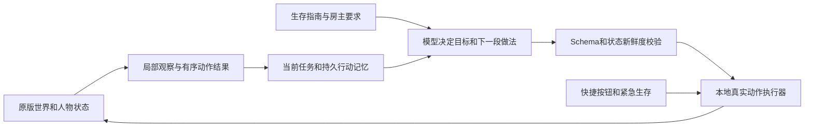

# 0.8.0架构与继续适配其他游戏

## 数据与控制闭环

模型负责选择目标、依赖与工作方法；本地负责连续执行、实际材料／科技／距离检查和紧急避险。不能因为一段攻略说“烧树得炭”，就把没有对应执行流程的动作当作已经适配。

## 源码入口

- `mod/modmain.lua`：游戏挂接、RPC和F10入口。
- `components/aicompanionmanager.lua`：绑定房主、局部快照、桥接通信、动作与聊天回执。
- `components/aicompanion.lua`：人物行为、生存优先级、动作事件和原版存档。
- `ai_tasks.lua`：根目标、有限阶段、实际进度、暂停恢复与有界方法修订。
- `ai_crafting.lua`、`ai_procurement.lua`、`ai_inventory.lua`：递归补料、科技前置、真实取物和仓储。
- `ai_navigation.lua`：路径受阻经验和有限旁路；不是全图资源扫描。
- `ai_projects.lua`：菜地、移植、储备等持久项目。
- `bridge/engine.mjs`：单请求调度、回执处理、事件触发与稳定期规划。
- `bridge/life.mjs`：事件游标、行动日志和目标板上下文。
- `bridge/timeline.mjs`：世界时间线与回滚隔离。
- `bridge/model.mjs`：从本地配置定位Codex，读取本项目角色，输出受限结构化计划。
- `bridge/diary.mjs`：本独立项目的自愿日记；不读取原作者的聊天系统。
- `tools/setup.mjs`：通用安装与随机令牌配置；`start.mjs`／`stop.mjs`核对本安装实例。

## 三个必须守住的边界

1. **任务与动作回执：** accepted只是接单，完成必须有实际后置结果；受阻或修订方法不能丢根目标和计数。
2. **本机指令接口：** 仅回环监听、鉴权、检查世界／会话／阶段；离线旧消息不补跑，取消后旧结果不再执行。预留的远程接口不等于已经捆绑QQ接入器。
3. **存档与记忆恢复：** 原版存档优先；执行记忆按世界分开，回滚不能借旧对话复活不存在的建筑和物品。

## 复用到其他游戏

先填`docs/development/03-新游戏设计工作单.md`：实体如何创建、谁有控制权、如何感知、哪些动作原生可执行、如何确认成功、如何暂停、如何存档。

第一阶段只做完整闭环的一小段：观察 → 单个动作 → 明确结果 → 保存恢复。确认后再加入计划、依赖分解、跟随帮忙、远程UI和长期项目。不要先把大量游戏攻略塞进人设，后面才补执行器。

角色性格放稳定人设，游戏知识与当前世界记忆分开；未来接入聊天系统时，由接入器按用户、游戏和世界选择资料，不能把其他人的会话灌入当前游戏。
