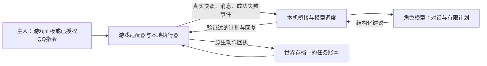

# 通用架构与制作流程

## 1. 把同伴拆成五个部分

| 部分 | 负责什么 | 以后换游戏时怎么处理 |
| --- | --- | --- |
| 角色与对话 | 人设、近期完整问答、重要事实、自愿日记、简短解释 | 尽量复用，游戏规则单独注入 |
| 模型调度 | 选择目标、解释攻略、判断是否发言；结构化输出、超时与取消 | 可复用思路和部分 Node 代码，重做能力 Schema |
| 游戏适配器 | 感知真实世界、提交原生动作、接收成功失败、保存人物 | 每款游戏重新适配，是主要工作量 |
| 本地执行与安全 | 走路、交互、跟随、避险、资源保护、任务恢复 | 状态机方法可复用，具体动作和阈值重做 |
| 玩家入口 | 游戏内聊天、远程呼叫、跟随/停下、最近发言；必要时 QQ 通知 | 保留体验，使用目标游戏的 UI 和输入接口 |

当前的饥荒适配器是 Lua 服务端模组，桥接是本机 Node HTTP；星露谷适配器使用 SMAPI/C#。这两个项目的实体、协议与保存实现并未统一成一个现成 SDK。

模型描述“打算制作”，游戏负责检查材料与真正制作。收到计划、开始动画和实际成功必须分开记录。

## 2. 先决定用什么样的同伴实体

优先调查原版玩家、可扩展 NPC、服务器机器人、官方/社区模组 API。只有确实需要时再考虑画面识别和键鼠控制。能读取状态和走原生动作的接口通常更容易验证，但也须检查是否依赖登录账号或独立客户端。

选择实体前回答：

- 能否独立持有背包、装备、属性、耐久和死亡状态？
- 能否在没有独立客户端时工作？哪些系统只对真实玩家更新？
- 同伴属于主机、服务器还是客户端？其他玩家是否能看见？
- 存档由谁保存？重载会不会重复生成、复制或丢失物品？
- 客户端专属 UI、角色能力、跨地图/分片系统是否可用？

如果采用 NPC 或影子玩家，逐项注明近似机制。例如“根据真实鱼表结算”仍不等于完整执行人类钓鱼小游戏。

## 3. 开工前的机制研究

按“当前运行时对象/注册表 → 对应版本本地源码或官方接口 → Wiki → 社区经验”的顺序核对。阅读社区是为了找到常用路线和陷阱，执行仍要采用实际世界的配方、库存和模组规则。

先列游戏系统：移动与地图、时间/季节、体力或生存、采集、装备、制作、仓储、种植、战斗、角色专属能力、剧情解锁、联机与模组。每项至少写清触发条件、资源成本、成功证据、失败原因和当前是否可执行。

记录网页 URL、查阅日期、适用游戏版本和源码位置。共享 Wiki 可能混有单机/联机分支；旧攻略、搜索摘要、HTTP 请求成功本身都不能代替正文和机制核对。

## 4. 用最小闭环验证技术路线

第一阶段只需要：读取主人位置与同伴状态 → 本地按钮发指令 → 提交一个真实移动或交互 → 读取实际结果 → 正常保存并重载。

在这个闭环稳定前，不急着加大量提示词或复杂攻略。否则模型会正确说出流程，但游戏执行器没有对应能力。

第二阶段完成远程入口：随处打开聊天、走到身边、持续跟随、停下、恢复自主、查看最近发言。集合与跟随是不同指令；便捷传送应单独标明，不能把它当作普通走路成功。

## 5. 每个动作都要有一份契约

动作适配至少包含：

| 项目 | 应说明什么 |
| --- | --- |
| 输入 | 目标物品/实体/位置、数量、作用范围、主人授权来源 |
| 前置条件 | 距离、地图、工具、耐久、体力、材料、科技、空间与权限 |
| 真正入口 | 原版动作、组件或主线程 API，禁止直接伪造成功状态 |
| 成功证据 | 原版完成事件、物品变动、建筑落地或真实到达 |
| 失败与重试 | 失败原因、临时排除、换目标、等待条件、重试上限 |
| 保存恢复 | 保存目标和实际计数；不要保存失效实体指针或旧时钟 |

游戏线程执行局部动作，模型只选择有限意图。工具获取和中间材料制作可使用配方依赖递归，但必须检查循环、深度、科技、输出容量和资源保护。

## 6. 用协议挡住迟到计划和重复执行

建议新适配器明确包含以下信息。字段名按项目决定，不能把此表直接视为当前两款游戏完全一致的协议。

- 身份范围：游戏、主人、世界、地图/分片、会话。
- 时序：状态序号、模式版本、请求有效期；新命令取消旧模型请求。
- 执行：唯一结果 ID、已应用回执、任务 ID、阶段、终态。
- 快照：同伴属性、背包、附近对象、已观察库存及其新旧程度、可用配方、事件、当前问题。
- 返回：对话、有限命令/计划、重要记忆/项目提议；字段、数量和长度受 Schema 限制。

饥荒当前使用 `session/revision/expires` 和唯一结果 ID，再核对 `taskGuard` 的任务 ID、阶段及终态。同一模式版本内任务也可能已经完成，因此仅检查 revision 还不够。

桥接超时和模型断开时，本地必须有明确策略。星露谷当前有约7秒桥接租约，过期停下；饥荒保留本地生存与既有动作，不依赖每次挥工具调用模型。两者策略不同，新游戏要主动选择并测试，不能默认照搬。

## 7. 从第一版保存任务连续性

把当前目标当作游戏数据保存，而不是靠模型下一轮从聊天摘要里想起来。建议至少保存目标来源、阶段列表、当前索引、实际计数、暂停原因、最近检查点、完成证据和终态历史。

饥荒当前状态为 `active/paused/blocked/complete/cancelled`：

- 生存、战斗和临时存货：保留步骤，处理完恢复；临时原因写 `interruption`。
- 主人跟随、待命、回家、集合或撤退：暂停到明确恢复，不能时间到了就自行走开。
- 取消：保存取消终态；恢复自主不能复活旧目标。
- 新明确目标：替换并归档旧目标。
- 普通问题或攻略咨询：继续回答，同时保留工作。
- 缺条件：记录具体阻塞，有限重试或求助，不编造完成。

分步队列只使用有本地完成判据的动作。当前饥荒最多六步，支持收集、制作、移植、前往已记地点和存余货；农务、钓鱼、做饭、探索、休整和整理仍是持续活动。以后若要把持续活动放进队列，先实现“这一阶段什么时候结束”。

保护主人任务时，也要给她自己选择的持续生活活动留下调整空间。不能为了“不忘目标”让自主做饭或农务永远锁住后续生活。

## 8. 分清六种记忆

| 记忆 | 内容与用途 |
| --- | --- |
| 近期问答 | 最近完整对话，支撑连续提问；先处理更早记录的长度预算 |
| 重要事实与地点 | 基地、主人明确要求、重要偏好；带世界和位置来源 |
| 当前任务账本 | 正在做什么、做到哪步、如何恢复；由游戏事实主导 |
| 长期项目 | 菜地、移植区、定期照料、物资目标；独立于单次任务 |
| 条件性经验 | 成功/失败证据、适用条件、置信程度，可纠正或忘记 |
| 自愿日记 | 值得记录的主观经历；模型自行判断，不强制每次写 |

“家在这里”要锚定发送消息那一刻的主人位置，不能使用模型回复时的新位置。删除项目还应记录取消区域，否则自动发现可能马上重新登记。

跨游戏可共用人设和经授权的角色记忆；任务、物资、坐标与权限必须按游戏/主人/世界/分片隔离。不能把旧聊天、物品名、攻略或模组描述当成新的操作授权。移植到新服务之前检查私人记忆的共享范围；资料包不需要包含实际私人聊天和认证文件。

## 9. 攻略知识要经过执行能力核对

给模型同时提供“知道什么”和“现在能做什么”。把每条常用流程拆成前置条件、现有动作和成功证据；知识里没有对应动作的部分明确标记为未适配。

例如“建箱存货”实际需要：核对库存 → 获取缺料 → 加工木板 → 达到科技 → 找合法位置 → 真实建造 → 读取容量 → 转移余货。仅告诉模型箱子配方，无法补齐这条执行链。

新模组可以分为：原版标准接口可用、被动生效、只显示信息、部分适配、未知专属操作。客户端提示和专属 GUI 不能自动变成无客户端同伴的能力。学习经验可以改进选择，但不能凭记忆生成游戏中不存在的动作接口。

## 10. 交流和跟随要服务于实际游玩

主动交流采用独立事件候选与冷却，允许模型沉默。缺料、危险、完成和求助附上简短实际情境；旧问题消失后清掉候选。社交结果不能修改行动或清空任务。游戏内能表达的内容优先在游戏内显示，QQ 作为明确约定的补充渠道，不重复刷两边。

跟随协助读取附近主人真正完成的动作或当前工具，在有限距离内匹配已有安全动作；追赶优先于采集，不因模仿擅自砍树、拆建筑或消耗珍贵品。新游戏重新核对移动速度、奔跑、战斗距离、碰撞和地图切换。

开发结束前再检查 UI：编辑态和非编辑态文字颜色、中文输入、消息长度、世界是否暂停、按键冲突、聊天记录与展开阅读、手柄/不同分辨率。气泡短暂，重要内容还需要可回看的小窗。

> 此文是原型开发经验的脱敏归档，内部历史提交标记不属于本仓库的新建历史。本分享版以根目录README和当前源码为准。
